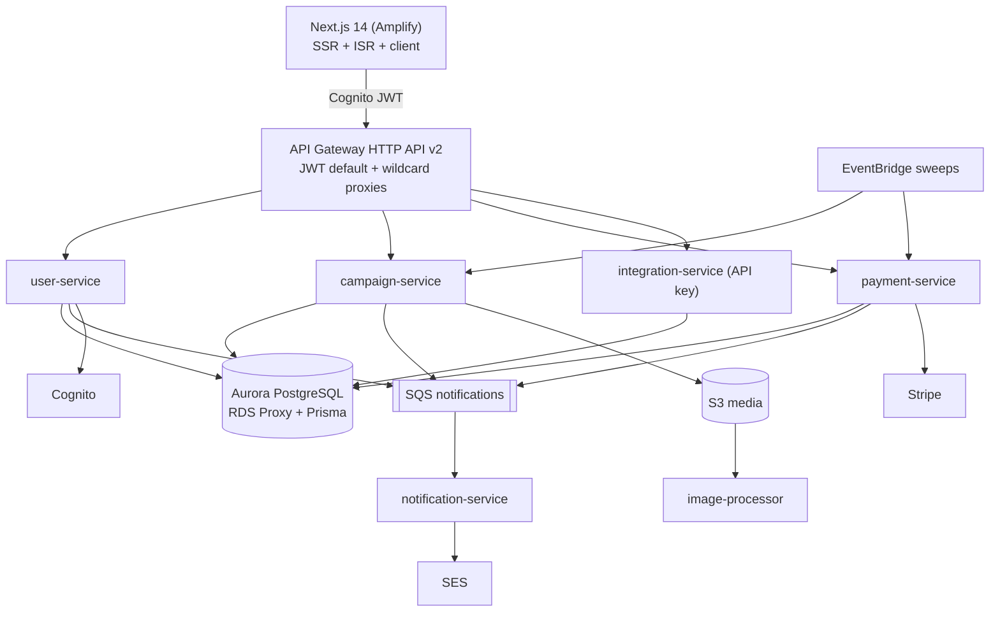

# Penyzen Backend — Issues & Recommended Fixes

**Scope:** backend services, database, infrastructure (CDK), testing, observability

**Purpose:** one place to see every issue, its priority, the recommended fix, and how to know it is done

**Priority legend:** 🔴 Critical · 🟠 High · 🟡 Medium · 🟢 Low

**How to read an issue**

- **What** — the problem.
- **Why** — impact if left alone.
- **How** — the recommended fix.
- **Where** — files and lines with the evidence.
- **Acceptance** — checks that prove the fix is complete.

**Contents**

1. [Database & Schema](#1-database--schema)
2. [Security & Secrets](#2-security--secrets)
3. [Authentication & Authorization](#3-authentication--authorization)
4. [Abuse Prevention & Rate Limiting](#4-abuse-prevention--rate-limiting)
5. [Code Structure & Maintainability](#5-code-structure--maintainability)
6. [Testing & Quality](#6-testing--quality)
7. [Observability & Operations](#7-observability--operations)
8. [Infrastructure & Deployment](#8-infrastructure--deployment)
9. [Error Handling & API Responses](#9-error-handling--api-responses)
10. [What to fix first](#10-what-to-fix-first)

---

## Current architecture

---

## 1. Database & Schema

#### DAT-0 — Generate Prisma types in the build

**Priority:** 🔴 Critical — do first

**What:** Prisma's client and TypeScript types are created only by a manual `prisma generate`. The `build` and `typecheck` commands never run it.

**Why:** A fresh clone cannot build or typecheck the database package until someone generates the client. CI works only because it runs the command by hand. Every other database issue depends on this.

**How:** Run `prisma generate` before `tsc` (prebuild/pretypecheck, or at the root). Make `npm ci && npm run build` and `npm run typecheck` pass with no manual step. Keep both binary targets. Document the command and where output goes.

**Where:** `packages/database/package.json:8,10`; `package.json:12`; `.github/workflows/ci.yml:35-36`; `packages/database/prisma/schema.prisma:9-13`

**Acceptance:**

- [ ] Fresh clone: `npm ci && npm run build` passes with no manual generate.
- [ ] Fresh clone: `npm run typecheck` passes.
- [ ] Generated client targets `native` and `linux-arm64-openssl-3.0.x`.
- [ ] The CI generate step is redundant or documented.

#### DAT-1 — Use Prisma Migrate as the single schema source

**Priority:** 🔴 Critical

**What:** The Prisma schema and 24 hand-written SQL files define the database separately, with no drift detection.

**Why:** The client schema and the applied schema can disagree until queries fail in production.

**How:** Adopt Prisma Migrate. Baseline dev/prod to `0000_init` (`prisma migrate diff` + `migrate resolve --applied`). Convert the SQL files. Run `prisma migrate deploy` in the migrator. Add a CI drift check.

**Where:** `packages/database/prisma/schema.prisma`; `services/db-migrator/src/migrations/`; `services/db-migrator/src/handler.ts:118-140`

**Acceptance:**

- [ ] `prisma migrate status` is clean in dev and prod.
- [ ] One migration pipeline remains.
- [ ] CI fails on schema drift.
- [ ] Existing data is preserved (baselined, not reset).

#### DAT-2 — Move data-mutating scripts out of the migration chain

**Priority:** 🟠 High

**What:** `0009_seed_dev_admin.sql` and `0012_purge_prelaunch_rogue_data.sql` run through the normal migration path.

**Why:** Running migrations on production can seed a dev admin or delete real data.

**How:** Move them to env-scoped tooling outside the migration chain. Give dev seeding its own command that refuses to run in production.

**Where:** `services/db-migrator/src/migrations/0009_seed_dev_admin.sql`; `services/db-migrator/src/migrations/0012_purge_prelaunch_rogue_data.sql`

**Acceptance:**

- [ ] The migration chain has schema changes only.
- [ ] A dev seed command exists and refuses to run in production.

#### DAT-3 — Align campaign category enums

**Priority:** 🟠 High

**What:** Shared types list 7 categories; shared constants and Prisma list 10 (adding `FUNERAL`, `DISASTER`, `GRADUATION`).

**Why:** Type checks pass while runtime data violates the type; values mismatch across services.

**How:** Generate shared enums from Prisma, or add a CI parity test across the three sources.

**Where:** `packages/shared/src/types/campaign.types.ts:3-10`; `packages/shared/src/constants/campaign.constants.ts:1-12`; `packages/database/prisma/schema.prisma`

**Acceptance:**

- [ ] A parity test fails CI on any mismatch.
- [ ] All three sources list the same categories.

#### DAT-4 — Fix or remove the `db:seed` script

**Priority:** 🟡 Medium

**What:** `db:seed` points to `prisma/seed.ts`, which does not exist.

**Why:** The command always fails; it confuses onboarding.

**How:** Create a real seed, or remove the script.

**Where:** `packages/database/package.json:14`

**Acceptance:**

- [ ] `npm run db:seed` succeeds, or the script is removed.

#### DAT-5 — Declare the missing `@penyzen/shared` dependency

**Priority:** 🟠 High

**What:** `packages/database/src/client.ts` imports `@penyzen/shared`, but the package does not declare it.

**Why:** The build works only by workspace hoisting; it breaks in isolation or stricter setups.

**How:** Add `@penyzen/shared` to dependencies. Add a workspace-dependency lint.

**Where:** `packages/database/src/client.ts:2`; `packages/database/package.json:17-19`

**Acceptance:**

- [ ] An isolated package build succeeds.
- [ ] Lint catches undeclared workspace imports.

#### DAT-6 — Add database integration tests

**Priority:** 🟠 High

**What:** Database tests mock Prisma. No test runs migrations or real queries.

**Why:** Migration and query correctness are unverified until production.

**How:** Add a disposable Postgres harness (Testcontainers) that applies migrations and runs repository tests in CI.

**Where:** `packages/database/src/donors.test.ts` (mock example)

**Acceptance:**

- [ ] The suite boots a disposable Postgres, applies migrations, and runs repository tests.
- [ ] The suite runs in CI on every PR.

#### DAT-7 — Make the Prisma Lambda layer reproducible

**Priority:** 🟠 High

**What:** `api-stack.ts` references `infra/lambda-layers/prisma`, which is not in the repo (built only in CI).

**Why:** A fresh clone cannot `cdk synth` or deploy; the layer content cannot be reviewed.

**How:** Build the layer from a documented procedure in CI and locally. (Needs DAT-0 for the generated client.)

**Where:** `infra/lib/stacks/api-stack.ts:53`

**Acceptance:**

- [ ] Fresh clone + documented command produces the layer; `cdk synth` succeeds.
- [ ] CI builds the layer from the documented procedure.

#### DAT-8 — Use one source for the platform fee

**Priority:** 🟠 High

**What:** Fee config disagrees: `.env.example` says 2.5%, shared constants default to 0, and notification code hardcodes `0.975`.

**Why:** Notification emails misreport net amounts to donors.

**How:** Use one fee source. Make notifications use the shared helper `calculateNetAmount`.

**Where:** `.env.example:14`; `packages/shared/src/constants/payment.constants.ts:7,31`; `services/notification-service/src/processors/donationReceived.ts:7`

**Acceptance:**

- [ ] No hardcoded fee constants remain outside the single source.
- [ ] A test asserts the email amount equals the shared calculation.

---

## 2. Security & Secrets

#### SEC-1 — Remove plaintext DB credentials from Lambda env

**Priority:** 🔴 Critical

**What:** The database password is written into Lambda environment variables (`DATABASE_URL`) and CloudFormation.

**Why:** Anyone with config read access gets DB credentials, and the secret cannot rotate without a code change.

**How:** Use RDS IAM auth (see SEC-2). Generate a short-lived token with `@aws-sdk/rds-signer` and pass it to Prisma via lazy client init, refreshed on cold start. Remove `DATABASE_URL` from `commonEnv`.

**Where:** `infra/lib/stacks/api-stack.ts:61-63,74`; `packages/database/src/client.ts:21`

**Acceptance:**

- [ ] No DB password appears in synthesized CloudFormation or Lambda env.
- [ ] Prisma connects with a token valid ≤ 15 minutes, refreshed on cold start.
- [ ] `DATABASE_URL` is removed from `commonEnv`.

#### SEC-2 — Enable RDS Proxy IAM authentication

**Priority:** 🔴 Critical

**What:** The RDS Proxy is created with `iamAuth: false`, which forces static credentials.

**Why:** Without IAM auth, SEC-1 cannot be fixed.

**How:** Set `iamAuth: true`. Grant the proxy IAM auth to the Lambda roles.

**Where:** `infra/lib/stacks/database-stack.ts:96`

**Acceptance:**

- [ ] `iamAuth: true` is set; a CDK test asserts it.
- [ ] The Lambda role has the proxy IAM auth grant.
- [ ] Connections succeed using IAM auth only.

#### SEC-3 — Automate secret rotation

**Priority:** 🟠 High

**What:** Rotating a key needs a manual code edit (`secretRev`, `replace-me` placeholders). Some functions ignore the version.

**Why:** Forgotten edits leave stale or placeholder secrets in production.

**How:** Use CDK-managed secret versions with a rotation schedule. Remove `secretRev`. Fail startup if a `replace-me` value is present in production.

**Where:** `infra/lib/stacks/api-stack.ts:94-97,104,542`

**Acceptance:**

- [ ] Rotation completes with no code change.
- [ ] No `replace-me` or `secretRev` constants remain.
- [ ] Startup rejects placeholders in production.

#### SEC-4 — Scope broad IAM policies

**Priority:** 🟠 High

**What:** SES, SNS, and CloudWatch Logs policies use `resources: ['*']`.

**Why:** A compromised function can act account-wide.

**How:** Scope SES to verified identity/configuration-set ARNs, SNS to specific topic/phone ARNs, and logs to the delivery-status log group.

**Where:** `infra/lib/stacks/api-stack.ts:292,314,322,336`

**Acceptance:**

- [ ] No `Resource: '*'` remains where a specific ARN is known.
- [ ] A CDK test fails if a wildcard returns.
- [ ] Notification and log flows still work.

#### SEC-5 — Replace the Amplify admin role

**Priority:** 🟠 High

**What:** The web deployment role uses `AdministratorAccess-Amplify`.

**Why:** It grants far more than build needs; any compromise is account-wide.

**How:** Replace it with a role scoped to build, artifact, and SSM needs.

**Where:** `infra/lib/stacks/web-stack.ts:75`

**Acceptance:**

- [ ] The admin managed policy is removed.
- [ ] Web deployment still succeeds with the reduced role.

#### SEC-6 — Limit media bucket CORS

**Priority:** 🟡 Medium

**What:** The media bucket allows all origins (`allowedOrigins: ['*']`).

**Why:** Any site can make cross-origin requests to the bucket.

**How:** Restrict to the app origins already defined in `api-stack.ts`.

**Where:** `infra/lib/stacks/storage-stack.ts:29`; `infra/lib/stacks/api-stack.ts:415-420`

**Acceptance:**

- [ ] CORS lists explicit origins only; no `'*'`.
- [ ] Upload and display flows work from all environments.

#### SEC-7 — Verify TLS in the migrator

**Priority:** 🟡 Medium

**What:** `db-migrator` uses `ssl: { rejectUnauthorized: false }`.

**Why:** It accepts any certificate (man-in-the-middle risk).

**How:** Use `sslmode=verify-full` with the RDS CA bundle.

**Where:** `services/db-migrator/src/handler.ts:90`

**Acceptance:**

- [ ] TLS verification is enabled; no `rejectUnauthorized: false`.
- [ ] Migration succeeds against a valid RDS certificate and fails against an untrusted one.

#### SEC-8 — Block replayed Stripe webhooks

**Priority:** 🟠 High

**What:** Webhook signatures are verified, but event IDs are not stored.

**Why:** A valid replayed event can be processed twice.

**How:** Store processed Stripe event IDs (unique constraint) and reject duplicates before any mutation.

**Where:** `services/payment-service/src/services/webhook.service.ts:18`; `services/user-service/src/services/kyc.service.ts:56`

**Acceptance:**

- [ ] A replayed signed event is rejected with no second state change (payment and KYC).
- [ ] Duplicate rejection happens before business mutation.
- [ ] A test replays one event and asserts a single transition.

#### SEC-9 — Grant access to the receipts bucket (or remove the env var)

**Priority:** 🟡 Medium

**What:** `S3_RECEIPTS_BUCKET` is set, but no `grantRead`/`grantPut` exists.

**Why:** Receipt reads and writes fail at runtime, or the setting misleads.

**How:** Add the needed grants, or remove the env var if it is unused.

**Where:** `infra/lib/stacks/api-stack.ts:77`

**Acceptance:**

- [ ] Receipt put/get succeeds at runtime, or the env var and references are removed.

---

## 3. Authentication & Authorization

#### AUT-1 — Put the access contract in the build

**Priority:** 🔴 Critical

**What:** The gateway uses wildcard proxies (`/v1/users/{proxy+}`, `/v1/admin/{proxy+}`, etc.). Each Lambda must enforce access on its own.

**Why:** The contract is not enforced by the build. A new route is safe only if someone remembers the checks. The access register already records divergence.

**How:** Adopt the approved contract in code. Centralize authorization helpers. Generate a route manifest from `routes.ts` and assert parity with the gateway (see AUT-6).

**Where:** `infra/lib/stacks/api-stack.ts:472-529`

**Acceptance:**

- [ ] The route parity test (AUT-6) is green.
- [ ] Every access-register row has an enforcement test.
- [ ] Authorization goes through shared helpers.

#### AUT-2 — Hide role and KYC fields on public profiles

**Priority:** 🟠 High

**What:** `GET /v1/users/{userId}` returns `role` and `kycStatus`.

**Why:** A public route leaks administrative fields.

**How:** Return only public fields: `id`, `name`, `avatarUrl`, `bio`, `isVerifiedBadge`, `createdAt`.

**Where:** `services/user-service/src/services/user.service.ts:27-43` (`role` :35, `kycStatus` :36)

**Acceptance:**

- [ ] A test asserts role, KYC, email, and phone are absent.
- [ ] No frontend feature depended on the removed fields.

#### AUT-3 — Make admin bootstrap atomic

**Priority:** 🔴 Critical

**What:** Bootstrap counts admins, then updates. Two concurrent callers can both pass. The route is open to any JWT while no admin exists.

**Why:** A race can create two admins, and an early attacker could become admin.

**How:** Make bootstrap atomic with a DB-level guard. Deny by default. Document the role transition rules.

**Where:** `services/user-service/src/services/user.service.ts:49-61`

**Acceptance:**

- [ ] A concurrency test proves only one admin can be minted.
- [ ] The route denies non-eligible callers by default.

#### AUT-4 — Route by specificity, not order

**Priority:** 🟠 High

**What:** The router scans routes linearly, so resolution depends on registration order.

**Why:** A new overlapping route can silently shadow another and skip the right handler.

**How:** Add precedence (static before params, deeper first) and test overlapping routes.

**Where:** `packages/lambda-router/src/router.ts:82-98`

**Acceptance:**

- [ ] Tests cover overlapping and static-vs-param routes.
- [ ] Resolution does not depend on registration order.

#### AUT-5 — Add edge role checks for admin routes

**Priority:** 🟠 High

**What:** Admin routes are protected only inside the Lambda (`requireAdmin`).

**Why:** One missing in-Lambda check exposes admin data; there is no second layer.

**How:** Authorize at the gateway where possible, and keep the centralized in-Lambda checks.

**Where:** `infra/lib/stacks/api-stack.ts:525-529`; `packages/database/src/guards.ts`

**Acceptance:**

- [ ] Tests assert 403 for non-admin callers on each admin route.
- [ ] Edge enforcement is configured where supported; gaps are documented.

#### AUT-6 — Add a route manifest and parity test

**Priority:** 🟠 High

**What:** Nothing proves declared routes match gateway exposure. The gap is noted in the access register.

**Why:** Routes can be added or over-exposed without detection.

**How:** Generate a manifest from each service's `routes.ts` and assert parity in a CDK test.

**Where:** `production-readiness/api-access-register.md:21-25,157`

**Acceptance:**

- [ ] CI fails when a route is added without a gateway mapping.
- [ ] Manifest generation is automatic.

#### AUT-7 — Trim the organization create response

**Priority:** 🟡 Medium

**What:** The create response includes the creator's member email.

**Why:** Minor over-exposure; reads already use a role-projected select.

**How:** Use the same projection as `organizationDetailSelect`.

**Where:** `services/user-service/src/services/org.service.ts:110` (select at `:26-55`)

**Acceptance:**

- [ ] A response test asserts the field boundary matches `organizationDetailSelect`.

---

## 4. Abuse Prevention & Rate Limiting

#### ABU-1 — Add gateway throttling and WAF

**Priority:** 🔴 Critical

**What:** The HTTP API has CORS only — no stage throttling and no WAF.

**Why:** Nothing stops brute force, credential stuffing, or flooding.

**How:** Set stage throttle limits with per-route overrides for auth, register, and OTP. Attach a WAF web ACL with managed rules and an IP rate rule.

**Where:** `infra/lib/stacks/api-stack.ts:411-433`

**Acceptance:**

- [ ] Throttle limits are set, with overrides on sensitive routes.
- [ ] A WAF web ACL is attached with managed rules and an IP rate rule.
- [ ] An abuse test returns 429 past the limit.

#### ABU-2 — Enforce the documented rate limits

**Priority:** 🔴 Critical

**What:** Limits are written in the access register but not enforced.

**Why:** Policy without code gives false assurance; auth, register, OTP, KYC, and API keys are open to abuse.

**How:** Add a Postgres-backed limiter — a `rate_limit` table keyed by `(scope, identifier, window)` with atomic upsert and cleanup — as shared middleware. Reuse the existing OTP pattern.

**Where:** `production-readiness/api-access-register.md:70-83,85-86`; `services/user-service/src/services/phone.service.ts` (reference)

**Acceptance:**

- [ ] Each documented limit has a 429 test on breach.
- [ ] Counters are atomic under concurrent requests.
- [ ] Cleanup keeps the table bounded.
- [ ] OTP limits move to (or match) the shared limiter.

#### ABU-3 — Cap request body size

**Priority:** 🟡 Medium

**What:** There is no gateway payload limit and no application-level 32 KiB check.

**Why:** Large payloads can exhaust memory and DB resources; the register specifies 32 KiB.

**How:** Set the gateway payload limit and reject bodies over 32 KiB in shared validation.

**Where:** `production-readiness/api-access-register.md:68`

**Acceptance:**

- [ ] An oversized body returns 400/413.
- [ ] The enforced limit matches the documented limit.

> **Already done (reference):** OTP rate limits exist in `services/user-service/src/services/phone.service.ts` (cooldown, window, attempt caps). Keep them and use them as the pattern for ABU-2.

---

## 5. Code Structure & Maintainability

#### STR-1 — Split the god-stack

**Priority:** 🟠 High

**What:** `api-stack.ts` (546 lines) holds Lambdas, IAM, routes, env, custom resources, and outputs.

**Why:** Every change touches one high-coupling file.

**How:** Split it into per-service constructs/stacks and reduce cross-stack exports.

**Where:** `infra/lib/stacks/api-stack.ts`

**Acceptance:**

- [ ] Each service's resources live in their own construct.
- [ ] Each stack synthesizes and deploys.
- [ ] `api-stack.ts` is composition only.

#### STR-2 — Use one shared auth middleware

**Priority:** 🟠 High

**What:** `requireAuth` is copied in three services.

**Why:** The copies drift independently.

**How:** Move it to a shared package and import it everywhere.

**Where:** `services/user-service/src/middleware/requireAuth.ts:11`; `services/campaign-service/src/middleware/requireAuth.ts:5`; `services/payment-service/src/middleware/requireAuth.ts:5`

**Acceptance:**

- [ ] One implementation exists and all three services use it.
- [ ] Auth tests pass for each service.

#### STR-3 — Extract the shared publish-readiness rule

**Priority:** 🟠 High

**What:** The publish-readiness rule is duplicated in campaign-service and payment-service, held together by a "keep in sync" comment.

**Why:** Duplicated business rules drift.

**How:** Move the rule to a shared domain module.

**Where:** `services/campaign-service/src/services/campaign.service.ts:297`; `services/payment-service/src/services/publish-reminder.service.ts:22` (comment `:18`)

**Acceptance:**

- [ ] Both callers use the shared rule; the comment is gone.
- [ ] The rule is tested once.

#### STR-4 — Use the shared logger

**Priority:** 🟡 Medium

**What:** `image-processor` uses `console.log`.

**Why:** Logs are not JSON and ignore `LOG_LEVEL`.

**How:** Use `logger` from `@penyzen/shared`.

**Where:** `services/image-processor/src/handler.ts:31,39,46,78`

**Acceptance:**

- [ ] No `console.*` remains; the `no-console` lint passes.
- [ ] Logs are structured and respect `LOG_LEVEL`.

#### STR-5 — Split oversized service files

**Priority:** 🟡 Medium

**What:** `pledge.service.ts` (593 lines), `org.service.ts` (453), and `campaign.service.ts` (449) carry many responsibilities.

**Why:** They are hard to navigate, review, and test.

**How:** Split by use case into focused modules. No behavior change.

**Where:** `services/campaign-service/src/services/pledge.service.ts`; `services/user-service/src/services/org.service.ts`; `services/campaign-service/src/services/campaign.service.ts`

**Acceptance:**

- [ ] Files are under ~300 lines.
- [ ] Existing tests pass unchanged.

#### STR-6 — Use Handlebars for pledge emails

**Priority:** 🟡 Medium

**What:** `itemPledge.ts` uses inline HTML; other emails use Handlebars.

**Why:** Two rendering styles live in one service.

**How:** Move to Handlebars templates in `packages/email-templates`.

**Where:** `services/notification-service/src/processors/itemPledge.ts`; `packages/email-templates/src/renderer.ts`

**Acceptance:**

- [ ] No inline HTML literals remain in the processor.
- [ ] Templates render in tests.

#### STR-7 — Reduce cross-stack export coupling

**Priority:** 🟠 High

**What:** Stacks depend on string `CfnOutput` exports and `addDependency` chains.

**Why:** Renaming or removing an export can block whole-account deploys.

**How:** Prefer direct construct references and shared props over string exports.

**Where:** `infra/bin/penyzen.ts`

**Acceptance:**

- [ ] A stack rename/diff does not need import surgery.
- [ ] String exports are replaced by construct references where possible.

#### STR-8 — Remove dead dependencies and fix non-portable scripts

**Priority:** 🟢 Low

**What:** Unused dependencies (`@penyzen/shared` in email-templates; `zod`, `@aws-amplify/ui-react` in web) and `clean: "rm -rf dist"` scripts.

**Why:** Noise, and `rm -rf` fails on Windows.

**How:** Remove unused dependencies. Use cross-platform scripts.

**Where:** `packages/email-templates/package.json`; `apps/web/package.json`; `packages/database/package.json:15`

**Acceptance:**

- [ ] Unused dependencies are removed (keep `zod` in web — it is used by the frontend fix).
- [ ] `npm ci` and `clean` work on Windows.

---

## 6. Testing & Quality

#### TST-1 — Add tests for notification-service

**Priority:** 🟠 High

**What:** No `*.test.ts` exists under `services/notification-service/`.

**Why:** Failures in processors, batching, or templates go unnoticed.

**How:** Cover processors, partial-batch failures (`handler.ts`), SES chunking, and template errors.

**Where:** `services/notification-service/`

**Acceptance:**

- [ ] Every processor has tests.
- [ ] Partial-batch failure and SES chunking are asserted.
- [ ] The suite is green in CI.

#### TST-2 — Add tests for image-processor

**Priority:** 🟠 High

**What:** No `*.test.ts` exists under `services/image-processor/`.

**Why:** Variant generation and the decompression limit are unverified.

**How:** Cover variant generation, skip lists, and the decompression limit.

**Where:** `services/image-processor/`

**Acceptance:**

- [ ] Variant output, skip lists, and decompression rejection are asserted.
- [ ] The suite is green in CI.

#### TST-3 — Add tests for email-templates

**Priority:** 🟠 High

**What:** No `*.test.ts` exists under `packages/email-templates/`.

**Why:** A missing or broken template fails at send time.

**How:** Render every template with sample data and assert missing templates fail loudly.

**Where:** `packages/email-templates/`

**Acceptance:**

- [ ] Every template has a render test (new templates are auto-discovered).
- [ ] The missing-template case throws a tested error.

#### TST-4 — Add tests for db-migrator

**Priority:** 🟠 High

**What:** No `*.test.ts` exists under `services/db-migrator/`.

**Why:** Bootstrap, ordering, and idempotency are untested.

**How:** Cover bootstrap, idempotency, ordering, and rollback using the DAT-6 harness.

**Where:** `services/db-migrator/`

**Acceptance:**

- [ ] Tests cover bootstrap, idempotency, and ordering.
- [ ] The suite runs against ephemeral Postgres in CI.

#### TST-5 — Add infrastructure tests

**Priority:** 🟠 High

**What:** No CDK assertion or snapshot tests exist under `infra/`.

**Why:** Route, IAM, and security-group regressions ship unnoticed.

**How:** Assert routes, IAM scoping, security groups, and the public-route list.

**Where:** `infra/`

**Acceptance:**

- [ ] CDK tests assert routes, IAM scoping, and security groups.
- [ ] Tests run in CI.

#### TST-6 — Add notification event contract tests

**Priority:** 🟡 Medium

**What:** No test proves every event type has a consumer handler.

**Why:** An event type can be added with no handler and be dropped silently.

**How:** Add a producer↔consumer parity test.

**Where:** `packages/shared/src/types/notification.types.ts:206`; `services/notification-service/src/processors/index.ts:15-56`

**Acceptance:**

- [ ] Adding an event type without a handler fails CI.
- [ ] All current event types resolve to handlers.

#### TST-7 — Add web flow tests

**Priority:** 🟡 Medium

**What:** Only `api.test.ts` and `require-admin.test.ts` exist in the web app.

**Why:** Donate, auth, and admin flows have no UI coverage.

**How:** Add React Testing Library + jsdom tests for donate, auth, and admin flows.

**Where:** `apps/web/src/lib/api.test.ts`; `apps/web/src/lib/require-admin.test.ts`

**Acceptance:**

- [ ] Component tests cover donate, auth, and admin gating.
- [ ] The suite runs in CI.

#### TST-8 — Set coverage gates

**Priority:** 🟢 Low

**What:** `vitest.config.ts` has no coverage thresholds.

**Why:** Coverage can decay unnoticed.

**How:** Add thresholds and a CI coverage artifact.

**Where:** `vitest.config.ts`

**Acceptance:**

- [ ] CI enforces coverage thresholds.
- [ ] A coverage artifact is published per run.

---

## 7. Observability & Operations

#### OBS-1 — Add end-to-end correlation IDs

**Priority:** 🟠 High

**What:** The router does not attach a request ID; audit context exists only locally.

**Why:** Cross-service failures are hard to trace.

**How:** Propagate a request ID through logs, events, and error responses.

**Where:** `packages/lambda-router/src/router.ts`; `services/user-service/src/services/org.service.ts:63`

**Acceptance:**

- [ ] One request ID appears across service logs for a single request.
- [ ] The request ID is present in events and error responses.

#### OBS-2 — Route alarms to a topic

**Priority:** 🟡 Medium

**What:** `alarmTopicArn` is declared but unused; alarms have no target.

**Why:** Error and DLQ alarms fire with no notification.

**How:** Wire alarms to an SNS topic (PagerDuty/email).

**Where:** `infra/lib/constructs/lambda-function.ts:24,78-95`

**Acceptance:**

- [ ] Every alarm targets the topic.
- [ ] A test alarm produces a notification.

#### OBS-3 — Add a durable audit trail

**Priority:** 🟠 High

**What:** Audit logging exists in only parts of user-service; most privileged actions are not recorded.

**Why:** No forensics for incidents, and no accountability record.

**How:** Emit central audit events per the access register, with redaction of tokens, OTP, EIN, and raw emails.

**Where:** `services/user-service/src/services/org.service.ts:57-63`

**Acceptance:**

- [ ] Privileged actions emit and persist audit events.
- [ ] Redaction is verified by a test.
- [ ] Audit writes do not block the main path.

#### OBS-4 — Define SLOs, dashboards, and a restore drill

**Priority:** 🟡 Medium

**What:** There are no SLOs or dashboards, and the Aurora backup restore is untested.

**Why:** "Healthy" is undefined, and recovery is assumed.

**How:** Define SLOs mapped to alarms and dashboards. Run and document a backup/restore test.

**Where:** (no definitions exist)

**Acceptance:**

- [ ] SLOs are documented and mapped to alarms/dashboards.
- [ ] Dashboards exist for the golden signals.
- [ ] A restore drill is executed and documented.

---

## 8. Infrastructure & Deployment

#### INF-1 — Require approval for production deploys

**Priority:** 🟡 Medium

**What:** `cdk deploy --all --require-approval never` deploys without a gate.

**Why:** Any merged change auto-deploys to production.

**How:** Require approval for production, or scope `never` to dev only.

**Where:** `infra/package.json:8`

**Acceptance:**

- [ ] Production deploy requires approval.
- [ ] Dev deploys stay unattended.

#### INF-2 — Pass the environment explicitly

**Priority:** 🟡 Medium

**What:** The environment is derived from a stack-name string check (`stackName.includes('prod')`).

**Why:** A rename changes behavior silently.

**How:** Pass the environment as an explicit parameter.

**Where:** `infra/lib/constructs/lambda-function.ts:43`

**Acceptance:**

- [ ] The environment is an explicit parameter.
- [ ] No stack-name string checks remain.

#### INF-3 — Clean the CDK context

**Priority:** 🟢 Low

**What:** `cdk.context.json` lists account `34********27`, which is not in the OIDC setup doc.

**Why:** Stale context can cause wrong behavior on synth.

**How:** Remove the stale context.

**Where:** `infra/cdk.context.json`; `infra/oidc/SETUP.md`

**Acceptance:**

- [ ] Context lists only active accounts.

---

## 9. Error Handling & API Responses

#### ERR-1 — Centralize error handling in one place

**Priority:** 🟠 High

**What:** Error handling is spread across every Lambda. The shared `errorResponse` mapper and the `AppError` hierarchy already exist, but each function must remember to call them, and any throw that is not an `AppError` falls through to a generic 500 with no context.

**Why:** Responses drift between services: some leak stack traces or internal messages, others map the same error to different status codes. Clients cannot rely on one error contract, and support cannot trace a failure to a request.

**How:** Route every Lambda through one error handler in the router so handlers never format errors themselves. Map the known errors (`ValidationError` → 400, `UnauthorizedError` → 401, `ForbiddenError` → 403, `NotFoundError` → 404, `ConflictError` → 409) to their statuses and codes, and return `500 INTERNAL_ERROR` for anything unexpected without leaking internals. Log the unexpected error once, with its stack, and attach a request/correlation ID to the response.

**Where:** `packages/lambda-router/src/router.ts:70` (catch → `errorResponse`); `packages/shared/src/utils/response.ts:64` (`errorResponse`); `packages/shared/src/errors/`

**Acceptance:**

- [ ] Every Lambda returns errors through the one shared handler; handlers do not format their own error responses.
- [ ] Known errors map to documented status codes; unexpected errors return `500` with no internal detail.
- [ ] Each error response carries a request/correlation ID.
- [ ] An unexpected error is logged once, with the stack trace.

#### ERR-2 — Enforce one API response shape everywhere

**Priority:** 🟠 High

**What:** Success uses the shared envelope (`ok`, `created`, `noContent`, `raw`) and errors use `errorResponse`, but the shape is not enforced or documented end to end, so an endpoint can still return an ad-hoc body.

**Why:** The web app must handle more than one response shape and cannot reliably read `error.fields` for form validation, which is the root cause behind the weak frontend error handling in `penyzen-frontend-codebase-review.md` (P5).

**How:** Make the envelope the only response contract and document it: success is `{ success: true, data, meta? }`, error is `{ success: false, error: { code, message, fields? } }`. Keep every helper in the shared module the single source of that shape, publish the error-code catalog, and add a test that fails when a handler returns anything outside the envelope.

**Where:** `packages/shared/src/utils/response.ts`; `packages/shared/src/utils/response.test.ts`

**Acceptance:**

- [ ] Every endpoint returns the documented envelope (success or error).
- [ ] The error-code catalog is documented and stable.
- [ ] A test fails on any response that breaks the envelope.
- [ ] The frontend can map `error.fields` to form inputs.

---

## 10. What to fix first

Database first, then critical security, then the rest.

| Order | Focus | Issues |
|---|---|---|
| 1 | Database foundation | DAT-0, DAT-1, DAT-7 |
| 2 | Critical security & access | SEC-1, SEC-2, AUT-1, AUT-3, ABU-1, ABU-2 |
| 3 | High | SEC-3, SEC-4, SEC-5, SEC-8, AUT-2, AUT-4, AUT-5, AUT-6, DAT-2, DAT-3, DAT-5, DAT-6, DAT-8, STR-1, STR-2, STR-3, STR-7, TST-1, TST-2, TST-3, TST-4, TST-5, OBS-1, OBS-3, ERR-1, ERR-2 |
| 4 | Medium | SEC-6, SEC-7, SEC-9, AUT-7, DAT-4, ABU-3, STR-4, STR-5, STR-6, TST-6, TST-7, OBS-2, OBS-4, INF-1, INF-2 |
| 5 | Low | STR-8, TST-8, INF-3 |