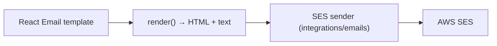

# Penyzen Backend — Architecture We Follow

**Scope:** backend services, database, infrastructure (CDK), and external integrations (email, notifications, payments)

**Purpose:** one concrete architecture — responsibilities, structure, and the patterns we actually use — not a menu of options

**How to read this doc**

- **Architecture** — the one shape we build toward.
- **Responsibilities** — what each layer owns and what it must never do.
- **Structure** — where code lives.
- **Rules** — the non-negotiables that keep the structure intact.

**Contents**

1. The architecture we follow
2. Responsibilities
3. Folder structure
4. Feature anatomy
5. The common layer
6. External integrations
7. Cross-cutting concerns
8. Email: react-email and AWS SES
9. Testing
10. Migration path & API Stack Refactor
11. Rules

---

## 1. The architecture we follow

- **Clean.** Dependencies point inward. Services hold the business logic and know nothing about HTTP or AWS; controllers and integrations depend on services, never the reverse.
- **DDD.** Each folder under `services/` is a feature domain: `users`, `campaigns`, `donations`. Model aggregates, value objects, and domain events only where the complexity earns it — a feature does not need all of them.
- **Hexagonal only where needed.** External systems are reached through a thin integration function. A feature never imports a provider SDK or its types directly.
- **One lifecycle.** Every request moves the same way:

  `handler → router → controller → service → integration / repository → response`

There are **no `domain/`, `application/`, or `adapters/` directories.** We separate by responsibility, not by ceremony.

---

## 2. Responsibilities

| Layer | Location | Owns | Never does |
|---|---|---|---|
| Handler | `<feature>/handler.ts` | The feature's single Lambda entry: composition root that builds the router and middleware | Business logic |
| Router | `<feature>/router.ts` | The feature's router instance, exported as the default: registers `method + path → controller` with middleware | Business logic |
| Public interface | `<feature>/index.ts` | The only surface other features and the app may import | Re-export internals |
| Controller | `<feature>/controllers/*.ts` | Parse and validate input, auth checks, call a service, return the response envelope and status code | Talk to the database or an SDK directly |
| Service | `<feature>/services/*.ts` | Business logic, orchestration, transactions, domain rules | Know about HTTP, Lambda, or AWS |
| Integration | `integrations/**` | Every external call: HTTP, email, SMS, queues, payments | Hold feature business rules |
| Common | `services/common/**` | Shared kernel: envelope, errors, pagination, middleware, config, logging | Feature-specific logic |

---

## 3. Folder structure

```text
services/
  common/                     # shared kernel — no feature logic
    responses.ts              # success/error envelope helpers
    errors.ts                 # AppError hierarchy
    error-handler.ts          # one centralized handler
    pagination.ts
    config.ts
    logging.ts
    middleware/               # only when there are >= 3 files

  users/                      # feature domain (no "-service" suffix)
    handler.ts                # this feature's Lambda entry (composition root)
    router.ts                 # this feature's router (routes → controllers)
    index.ts                  # public interface — the only import other parts use
    user.requests.ts
    user.responses.ts
    types.ts                  # optional
    schema.ts                 # optional
    controllers/              # only when there are >= 3 files
    services/                 # only when there are >= 3 files
    repository.ts             # optional: persistence access
    events.ts                 # optional: domain events this feature publishes

  campaigns/                  # same shape as users
  donations/

  integrations/               # all external systems, one place
    common/
      http.ts                 # one HTTP client (base URL, auth, timeout, correlation id)
      circuit-breaker.ts      # breaker + retry/backoff helper
    emails/                   # react-email templates + SES sender
    notifications/
    payments/
      common/                 # provider-agnostic payment logic
      stripe/                 # one folder per provider
      <provider>/

  tests/
    users/*.{spec,test}.ts
    campaigns/*.{spec,test}.ts
    integrations/*.{spec,test}.ts
```

Rule of thumb: a subdirectory exists only when a folder would hold **3 or more** similar files; otherwise the files stay flat and lean.

---

## 4. Feature anatomy

A feature is self-contained. It exposes one public interface, owns its own Lambda entry and routes, and keeps its internals private.

- **`handler.ts`** — the feature's single Lambda entry and composition root. It imports the feature's router, attaches global middleware once at cold start, and exports the handler. Lambda calls only this.

  ```ts
  import type { APIGatewayProxyEventV2, Context } from 'aws-lambda';
  import { loggingMiddleware } from '../common/middleware/logging';
  import usersRouter from './router';

  usersRouter.use(loggingMiddleware); // once per cold start

  export const handler = async (event: APIGatewayProxyEventV2, context: Context) => {
    context.callbackWaitsForEmptyEventLoop = false;
    return usersRouter.handle(event);
  };
  ```

- **`router.ts`** — the feature's router, built once and exported as the default. It registers routes by chaining the HTTP verb methods and attaches per-route middleware. It contains no business logic.

  ```ts
  import { Router } from '@penyzen/lambda-router';
  import { requireAuth } from '../common/middleware/auth';
  import * as userController from './controllers/user.controller';

  const usersRouter = Router();

  usersRouter.get('/v1/users/me', requireAuth, userController.getMe);
  usersRouter.patch('/v1/users/me', requireAuth, userController.updateMe);
  usersRouter.get('/v1/users/{userId}', requireAuth, userController.getUser);

  export default usersRouter;
  ```

- **`index.ts`** — the public interface. The only file another feature or the app may import. Export types, published domain events, and the feature's public functions — never controllers, services, or internals.
- **`<feature>.requests.ts`** — every request's Zod schema and its inferred type, exported together.

  ```ts
  export const createCampaignSchema = z.object({ title: z.string().min(1) });
  export type CreateCampaignInput = z.infer<typeof createCampaignSchema>;
  ```

- **`<feature>.responses.ts`** — response types and the functions that map domain objects to them.
- **`types.ts`** *(optional, recommended)* — the feature's own domain types.
- **`schema.ts`** *(optional)* — a persistence or model schema when it is distinct from the request schema.
- **`controllers/`** — one file per resource; created only when there are 3 or more controllers.
- **`services/`** — business logic; created only when there are 3 or more services.
- **`repository.ts`** *(optional)* — persistence access for the feature's aggregates.
- **`events.ts`** *(optional)* — domain events this feature publishes for other features to consume.

### The public interface

A feature communicates with the rest of the system only through its `index.ts`. This is what keeps its internals free to change.

- Other features, the app, and tests import from `<feature>/index.ts` — never from `<feature>/controllers/*` or `<feature>/services/*` directly.
- The interface exposes: request and response types, published domain events, and a small set of public functions.
- If another feature needs something that is not exported, add it to the interface deliberately — never reach into internals.

Rules:

- Request validation and its type live in the same file — one source of truth.
- `handler.ts` wires, `router.ts` routes, controllers translate, services decide.
- Controllers translate HTTP into a service call; they never contain business rules.
- Services receive plain input, return plain output, and throw the shared `AppError` hierarchy on failure.
- Cross-feature calls go through the other feature's `index.ts` only.

---

## 5. The common layer

`services/common` is the shared kernel. It holds only what every feature needs and nothing that belongs to a feature.

- **Response envelope** — `ok`, `created`, `noContent`, `errorResponse`.
- **Errors** — the `AppError` hierarchy and the single `error-handler.ts` that maps them to status codes.
- **Pagination** — one cursor/offset shape shared by every list endpoint.
- **Middleware** — auth, validation, logging, rate limiting, applied in a fixed order.
- **Config** — typed, validated at startup; no scattered `process.env` reads.
- **Logging** — structured logs carrying a request/correlation id.

The same "3 or more files → subdirectory" rule applies: keep `common/` flat until a concern genuinely needs its own folder.

---

## 6. External integrations

All external systems live under `integrations/` and are reached through a thin, typed function. Features never import an SDK directly.

- **`integrations/common/http.ts`** — the single HTTP client: base URL, auth header, timeout, and correlation id in one place.
- **`integrations/common/circuit-breaker.ts`** — wraps an external call with retry and circuit breaking.

Applied on external calls **where needed**:

- **Retry with exponential backoff** (with jitter) for transient failures.
- **Circuit breaker** for unstable providers — stop calling a failing dependency and fail fast.
- **Timeout** on every external call so nothing hangs.
- **Idempotency key** on payments and notifications so retries are safe.

Per provider, use one folder with a shared `common/` and one folder per vendor:

```text
integrations/payments/
  common/          # provider-agnostic logic (amounts, statuses, our types)
  stripe/          # Stripe SDK + mapping
  <provider>/      # another vendor
```

A feature calls something like `payments.charge(...)`, never `stripe.charges.create(...)`.

---

## 7. Cross-cutting concerns

Handled once, in `services/common`, and used by every feature:

- **API response shape** — success `{ success: true, data, meta? }`, error `{ success: false, error: { code, message, fields? } }`.
- **Centralized error handling** — one handler maps the `AppError` hierarchy to statuses; unexpected errors become `500` with no internals and are logged once.
- **Middleware** — auth, validation, logging, and rate limiting run in a fixed order.
- **Pagination** — one shape shared by every list endpoint.
- **Configuration** — typed and validated at startup.
- **Logging and correlation** — structured logs carrying a request/correlation id.

See issues ERR-1, ERR-2, OBS-1, and STR-* in the backend review for the current gaps.

---

## 8. Email: react-email and AWS SES

Email is an integration like any other and lives under `integrations/emails`.



- Templates are React components with typed props.
- Render once with `@react-email/render` to both HTML and plain text.
- Send through `@aws-sdk/client-sesv2` from one sender module in `integrations/emails`.
- A template registry maps an event/name to a template and its props.
- Local preview with the react-email dev server; snapshot tests for rendered output.
- No hand-written HTML strings anywhere in a feature.

---

## 9. Testing

Tests are organized under a `tests/` folder that mirrors the feature structure — the same on the backend and the frontend.

```text
services/tests/
  users/
    user.service.spec.ts
    user.controller.test.ts
  campaigns/
  integrations/
```

| Scope | Where | Stack |
|---|---|---|
| Backend logic and API | `services/tests/<feature>/*.{spec,test}.ts` | Vitest + Supertest |
| Frontend logic and components | `apps/web/tests/<feature>/*.{spec,test}.ts` | Vitest + Testing Library + MSW |
| End-to-end | `e2e/` at the repo root | Playwright |
| Infrastructure (CDK) | `infra/` | Jest |

Rules:

- Use `.spec.ts` or `.test.ts` for the test files.
- Supertest drives the route/controller path without a running server.
- The HTTP client in `integrations/common/http.ts` is the seam for mocking external calls.

---

## 10. Migration path & API Stack Refactor

### Feature-folder migration

1. **Rename folders to the feature name.** `services/campaign-service` → `services/campaigns`, `services/user-service` → `services/users`, `services/payment-service` → `integrations/payments`, `services/notification-service` → `integrations/notifications`.
2. **Flatten each feature.** Move `src/{controllers,services,schemas}` to the feature root: `controllers/`, `services/`, and `<feature>.requests.ts` / `<feature>.responses.ts`. Add `handler.ts`, `router.ts`, and `index.ts` so the feature owns its entry, routes, and public interface. Drop `domain/`, `application/`, and `adapters/` if present.
3. **Move the shared kernel.** `packages/shared` → `services/common`; update imports.
4. **Move integrations.** Push all external calls under `integrations/`, with `common/http.ts` and `common/circuit-breaker.ts` first.
5. **Move tests.** Collect them under `services/tests/<feature>/`.
6. **Keep routes unchanged.** Migrate behind stable endpoints so each step ships independently.

### The API Stack refactor (`api-stack.ts`)

The application currently runs as a set of separate feature folders under `services/`, but the AWS CDK configuration (`api-stack.ts`) suffers from **Infrastructure Overlap**. Because paths like `/v1/users/me/campaigns` belong to the `campaigns` domain but sit textually inside the `/v1/users` namespace, the CDK has become brittle, requiring verbose, explicit route additions to manage request routing precedence.

To fix this, we move to a **Clean Proxy-Delegation Pattern** in the CDK. The CDK stays short and maintenance-free, while each feature directory keeps absolute autonomy.

Instead of listing every individual route path explicitly inside the CDK stack, the `ApiStack` maps only high-level root paths using a proxy wildcard (`{proxy+}`). This hands complete routing control back to each feature's `handler.ts` and `router.ts`.

```typescript
// infrastructure/stacks/api-stack.ts
const userIntegration = new integrations.HttpLambdaIntegration('UserIntegration', userServiceLambda.fn);
const campaignIntegration = new integrations.HttpLambdaIntegration('CampaignIntegration', campaignServiceLambda.fn);
const paymentIntegration = new integrations.HttpLambdaIntegration('PaymentIntegration', paymentServiceLambda.fn);

const noAuth = { authorizer: new apigatewayv2.HttpNoneAuthorizer() };
const proxyMethods = [
  apigatewayv2.HttpMethod.GET,
  apigatewayv2.HttpMethod.POST,
  apigatewayv2.HttpMethod.PUT,
  apigatewayv2.HttpMethod.PATCH,
  apigatewayv2.HttpMethod.DELETE,
];

// ── 1. Authenticated wildcard root proxies ──────────────────────────────────
// API Gateway routes all requests under these prefixes cleanly down to the
// respective composition roots without maintaining an extensive path layout.
proxyMethods.forEach((method) => {
  this.api.addRoutes({ path: '/v1/users/{proxy+}', methods: [method], integration: userIntegration });
  this.api.addRoutes({ path: '/v1/organizations/{proxy+}', methods: [method], integration: userIntegration });
  this.api.addRoutes({ path: '/v1/campaigns/{proxy+}', methods: [method], integration: campaignIntegration });
  this.api.addRoutes({ path: '/v1/donations/{proxy+}', methods: [method], integration: paymentIntegration });
  this.api.addRoutes({ path: '/v1/admin/{proxy+}', methods: [method], integration: userIntegration });
});

// ── 2. Public wildcard proxies (bypass Cognito JWT) ─────────────────────────
this.api.addRoutes({ path: '/v1/auth/{proxy+}', methods: [apigatewayv2.HttpMethod.ANY], integration: userIntegration, ...noAuth });
this.api.addRoutes({ path: '/v1/webhooks/{proxy+}', methods: [apigatewayv2.HttpMethod.POST], integration: paymentIntegration, ...noAuth });
```

### The feature router and handler pattern

No `register<Feature>Routes` function and no plain route array — a plain array is easy to break and hard to extend. Each feature builds a router instance, registers routes by chaining the verb methods, and default-exports it. This is exactly what the proxy delegation lands on.

`services/users/router.ts`:

```typescript
import { Router } from '@penyzen/lambda-router';
import { requireAuth } from '../common/middleware/auth';
import * as userController from './controllers/user.controller';

const usersRouter = Router();

usersRouter.get('/v1/users/me', requireAuth, userController.getMe);
usersRouter.patch('/v1/users/me', requireAuth, userController.updateMe);
usersRouter.get('/v1/users/{userId}', requireAuth, userController.getUser);

export default usersRouter;
```

`services/users/handler.ts`:

```typescript
import type { APIGatewayProxyEventV2, Context } from 'aws-lambda';
import { loggingMiddleware } from '../common/middleware/logging';
import usersRouter from './router';

// Global scope initialization — runs once per container cold start.
usersRouter.use(loggingMiddleware);

export const handler = async (event: APIGatewayProxyEventV2, context: Context) => {
  // Clear the event loop so the Prisma connection is reused on warm starts.
  context.callbackWaitsForEmptyEventLoop = false;
  return usersRouter.handle(event);
};
```

Rules:

- No `register<Feature>Routes` function and no plain route array; build a router instance and default-export it.
- The feature registers all of its own routes; the CDK maps only root prefixes.
- A route path is owned end to end by one feature — no domain leaks into another feature's namespace.

---

## 11. Rules

- Dependencies point inward; services know nothing about HTTP or AWS.
- One lifecycle: `handler → router → controller → service → integration/repository → response`.
- No `domain/`, `application/`, or `adapters/` directories.
- Feature folders are named after the domain: `users`, `campaigns`, `donations` — never `users-service`.
- Every feature owns `handler.ts` (its Lambda entry) and `router.ts` (its router instance, default-exported); Lambda calls only the feature's handler.
- A feature exposes one public interface in `index.ts`; everything else is private.
- Cross-feature calls import the other feature's `index.ts` only.
- Every request schema and its inferred type live together in `<feature>.requests.ts`.
- A subdirectory appears only when a folder would hold 3 or more similar files; otherwise keep it flat.
- All external calls go through `integrations/`; features never import an SDK.
- Retry with backoff and a circuit breaker wrap external calls where needed.
- Every response uses the shared envelope; every error goes through the central handler.
- Tests live under `tests/<feature>/`, matching the structure they cover.
