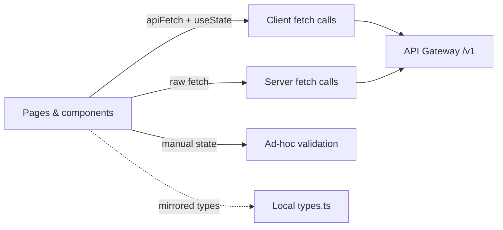

# Penyzen Frontend — Issues & Recommended Fixes

**Scope:** `apps/web` (and its contract with `packages/shared`)

**Purpose:** one place to see every issue, its priority, the recommended fix, and how to know it is done

**Priority legend:** 🔴 Critical · 🟠 High · 🟡 Medium

**How to read an issue**

- **What** — the problem.
- **Why** — impact if left alone.
- **How** — the recommended fix.
- **Where** — files and lines with the evidence.
- **Acceptance** — checks that prove the fix is complete.

**Contents**

1. [Contract & Types](#1-contract--types)
2. [Data Layer & Server State](#2-data-layer--server-state)
3. [Forms & Validation](#3-forms--validation)
4. [UI, UX & Accessibility](#4-ui-ux--accessibility)
5. [Performance & SEO](#5-performance--seo)
6. [Authentication](#6-authentication)
7. [Testing](#7-testing)
8. [What to fix first](#8-what-to-fix-first)
9. [Additional Security & Reliability Findings](#9-additional-security--reliability-findings)

---

## Current data flow

---

## 1. Contract & Types

#### P1 — Use one source for API types

**Priority:** 🔴 Critical

**What:** The web app mirrors backend types instead of importing `@penyzen/shared`, and the copies have already drifted (extra categories, `story` vs `description`, nested `organizer` vs `organizerName`).

**Why:** Type checks pass while runtime data does not match. Bugs appear on one screen and not another.

**How:** Make `@penyzen/shared` the single source. Expand it to the real API shape (categories including `GRADUATION`, `FUNERAL`, `DISASTER`; reconcile `story`/`description`). Delete `apps/web/src/lib/types.ts`. Have each feature `types.ts` re-export shared types and add only view types. Publish zod schemas in shared.

**Where:** `apps/web/src/lib/types.ts:1-2`; `packages/shared/src/types/campaign.types.ts`

**Acceptance:**

- [ ] No API/domain types are declared in the web app.
- [ ] Categories match Prisma.
- [ ] `story`/`description` and `organizer`/`organizerName` each use one name.
- [ ] Zod schemas are exported from shared.

---

## 2. Data Layer & Server State

#### P7 — Use one HTTP client

**Priority:** 🟠 High

**What:** Some screens use `apiFetch`; others use raw `fetch`. The server-only `PENYZEN_API_URL` is defined but never used.

**Why:** Envelope handling and error typing differ by screen; the configured server URL is dead.

**How:** Add an Axios client (`common/api/http.ts`) that unwraps `{success,data}` and throws a typed `ApiError { code, message, status, fields }`. Add a server variant (`common/api/http.server.ts`) that uses `PENYZEN_API_URL`. Remove raw `fetch` and the duplicated server fetchers. Keep Next `fetch(...,{next})` for ISR caching.

**Where:** `apps/web/src/app/organizations/page.tsx:25`; `apps/web/src/app/admin/page.tsx:34`; `apps/web/.env.example:2`

**Acceptance:**

- [ ] No page or component calls raw `fetch` for API traffic (RSC ISR fetch is the documented exception).
- [ ] One typed `ApiError` is thrown for envelope, HTML, and empty bodies.
- [ ] The server client uses `PENYZEN_API_URL`.

#### P2 — Use one server-state layer

**Priority:** 🔴 Critical

**What:** About 15 screens hand-roll `apiFetch().then().catch()` with `useState`. There is no cache, retry, or invalidation.

**Why:** Screens duplicate loading and error logic, double-fetch the same data, and go stale after mutations.

**How:** Add TanStack Query. Add a `QueryClientProvider`. Define query keys and `useQuery`/`useMutation` hooks per feature. Set defaults (`retry: 1`, per-resource `staleTime`).

**Where:** `apps/web/src/app/(dashboard)/dashboard/campaigns/page.tsx:47-59`; `donors/page.tsx:41`; `admin-*-section.tsx`

**Acceptance:**

- [ ] Dashboards read data via `useQuery`; no manual fetch + `useState` loops remain.
- [ ] Mutations invalidate the related query keys.
- [ ] The same query key is fetched once (dedup test).

#### P8 — Show API errors, not empty states

**Priority:** 🟠 High

**What:** Fetch failures are caught and rendered as empty lists.

**Why:** An outage looks like "no data", so incidents go unnoticed.

**How:** Distinguish three states: data, empty, error. Show an inline banner plus a toast with a retry on error. Show the empty state only on a successful empty response.

**Where:** `apps/web/src/app/page.tsx:38`; `apps/web/src/app/campaigns/page.tsx:19`; `apps/web/src/app/organizations/page.tsx:33`

**Acceptance:**

- [ ] A 5xx or network failure shows an error UI, never the empty state (test).
- [ ] The empty state shows only on a successful empty response.
- [ ] Error messages include request context where available.

---

## 3. Forms & Validation

#### P3 — Validate forms with React Hook Form + Zod

**Priority:** 🔴 Critical

**What:** Validation is ad-hoc. `zod` is installed but unused. Server `fields` errors are flattened into one string and never mapped to inputs. Some invalid submissions silently return.

**Why:** Users get no feedback and do not know what failed.

**How:** Use React Hook Form + `zodResolver` on every form, with schemas from `@penyzen/shared`. Map server `ApiError.fields` to RHF `setError` so messages show on the matching inputs. Remove silent returns.

**Where:** `apps/web/package.json:29`; `apps/web/src/app/(dashboard)/dashboard/api-keys/page.tsx:77`; `apps/web/src/app/(dashboard)/dashboard/campaigns/[id]/edit/page.tsx:223,255`

**Acceptance:**

- [ ] Every form uses RHF + `zodResolver` with a shared schema.
- [ ] Server field errors render on the matching inputs.
- [ ] No invalid submit ends silently.

---

## 4. UI, UX & Accessibility

#### P5 — Add complete Next.js error handling

**Priority:** 🟠 High

**What:** No `global-error.tsx`, `error.tsx`, `loading.tsx`, or `not-found.tsx` files exist under `src/app`. There is no route-level error UI, no loading skeleton, and no not-found page.

**Why:** A render error shows the default Next.js screen, a slow route shows a blank page, and an unknown URL or missing record shows a generic 404. Users get no clear message and no way to recover, and the app feels broken rather than smart.

**How:** Add the full App Router error surface and wire it to the API contract (ERR-2):

- `global-error.tsx` at the root for fatal errors, with its own `<html>` and `<body>`.
- `error.tsx` per route group for recoverable errors, with a friendly message and a `reset()` retry button.
- `not-found.tsx` plus `notFound()` calls for unknown campaigns, users, and pages.
- `loading.tsx` and `<Suspense>` skeletons for data-heavy routes.
- Map API status to the right UI: 401 → sign-in, 403 → forbidden message, 404 → not-found.
- Log the error and show a request/correlation ID from the API so support can trace it.

**Where:** `apps/web/src/app/**` (none exist)

**Acceptance:**

- [ ] `global-error.tsx`, `error.tsx`, `loading.tsx`, and `not-found.tsx` exist for each route group that needs them.
- [ ] `error.tsx` shows a friendly message and a retry (`reset()`); no stack trace is shown in production.
- [ ] Unknown routes and missing resources render the not-found page (404), not a blank or error screen.
- [ ] Slow routes stream a skeleton through `loading.tsx`/`Suspense`.
- [ ] A 401/403/404 from the API maps to sign-in, forbidden, and not-found UI respectively.
- [ ] Each error surfaces a request/correlation ID for support.

#### P4 — Fix accessibility

**Priority:** 🔴 Critical

**What:** Modals lack dialog semantics and focus management. Many inputs are unlabeled. Async results have no `aria-live`. Icon buttons are named only by `title`.

**Why:** Keyboard and screen-reader users cannot use key flows.

**How:** Label every input. Add `aria-live`/`role="alert"` for async messages. Replace `title`-only icon buttons with `aria-label`. Use shadcn `Dialog` for focus trap, Escape, and `aria-modal`.

**Where:** `apps/web/src/app/(dashboard)/dashboard/.../ui/image-editor-modal.tsx:112`; `publish-checklist-modal.tsx:123`; `admin-campaigns-section.tsx:173`; `.../profile/_components/phone-section.tsx:107,140`

**Acceptance:**

- [ ] All inputs are labeled.
- [ ] Modals trap focus, close on Escape, and set `aria-modal`.
- [ ] Async messages are announced.
- [ ] axe is clean on key pages and modals.

#### P6 — Build one UI system and remove duplicates

**Priority:** 🟠 High

**What:** Duplicate code: 3× `Field`, 2× invite pages, 2× campaign card, 3× `CATEGORIES`, 3× `STATUS_STYLES`, 3× `daysLeft`, and 2× shipping render.

**Why:** Duplicates drift; fixes must be repeated; the constants disagree.

**How:** Adopt shadcn/ui primitives in `common/components/ui`. Delete the duplicates. Single-source constants from shared.

**Where:** `apps/web/src/app/(auth)/*/page.tsx`; `invites/[token]` vs `org-invites/[token]`; `apps/web/src/app/page.tsx:374` vs `components/campaigns-browser.tsx:162`

**Acceptance:**

- [ ] One `Field`, one campaign card, one invite flow, and one status map remain.
- [ ] Modals, tables, and selects use the shared primitives.
- [ ] Constants come from shared.

#### P12 — Split fat components

**Priority:** 🟡 Medium

**What:** `pledges/[id]/page.tsx` (636 lines) and `edit/page.tsx` (784 lines) mix data, validation, state, and UI.

**Why:** They are hard to navigate, review, and test.

**How:** Move data and behavior into feature `queries.ts`. Keep components presentational and prop-driven.

**Where:** `apps/web/src/app/pledges/[id]/page.tsx`; `apps/web/src/app/(dashboard)/dashboard/campaigns/[id]/edit/page.tsx`

**Acceptance:**

- [ ] Pages compose; presentational components have no API or validation calls.
- [ ] Behavior is unchanged (tests pass).
- [ ] `_components` cannot import `api.ts` (lint boundary).

---

## 5. Performance & SEO

#### P10 — Use `next/image` for avatars and logo

**Priority:** 🟠 High

**What:** `remotePatterns` is configured but unused; avatars and the logo are raw `` without dimensions.

**Why:** Layout shift and missed optimization.

**How:** Use `next/image` with dimensions for avatars and the logo. Keep `CoverImage` for processed covers.

**Where:** `apps/web/next.config.mjs:4-11`; `apps/web/src/app/layout/header.tsx:10`

**Acceptance:**

- [ ] No raw dimension-less `` remains.
- [ ] CLS is measured before and after (no regression).
- [ ] `CoverImage` is unchanged.

#### P13 — Use one money and date formatter

**Priority:** 🟡 Medium

**What:** `formatCents` forces 0 decimals, while the donate panel uses `toFixed(2)`. Dates use several inline formats.

**Why:** The same amount shows differently across screens.

**How:** Add `common/lib/format.ts` with `centsToDollars` plus a currency formatter, and one date utility.

**Where:** `apps/web/src/lib/utils.ts:12`; `apps/web/src/components/donate-panel.tsx:354,365,386`

**Acceptance:**

- [ ] One money formatter is used; no ad-hoc `toFixed` on currency values.
- [ ] Unit tests cover 0, sub-dollar, and large values.
- [ ] One date utility is used.

#### P9 — Complete SEO metadata

**Priority:** 🟠 High

**What:** No OG, Twitter, canonical, or JSON-LD tags; no `sitemap.ts` or `robots.ts`; list pages lack `generateMetadata`.

**Why:** Shared campaign links render bare, and search indexing is missing.

**How:** Add `generateMetadata` (OG, Twitter, canonical) on home, list, and detail pages. Add campaign JSON-LD. Add `sitemap.ts` and `robots.ts`.

**Where:** `apps/web/src/app/campaigns/[id]/page.tsx:33-40`

**Acceptance:**

- [ ] Home, list, and detail pages emit OG, Twitter, and canonical tags.
- [ ] Campaign JSON-LD is valid.
- [ ] `sitemap.ts` and `robots.ts` return 200 in a production build.

---

## 6. Authentication

#### P11 — Centralize auth in one provider

**Priority:** 🟡 Medium

**What:** There are two registration paths (REST in register, Amplify in login). "Auth" is inferred from cookie presence. Sign-out does a full reload.

**Why:** The paths can diverge; expired cookies look authenticated; sign-out is jarring.

**How:** Add one `AuthProvider` (`useUser`, `useRequireRole`). Use one registration path. Check auth on the server. On sign-out, clear the query cache instead of reloading.

**Where:** `apps/web/src/app/(auth)/register/page.tsx:93` vs `apps/web/src/app/(auth)/login/page.tsx:34`; `items/.../item-registry-display.tsx:19-35`; `components/.../sign-out-button.tsx:20`

**Acceptance:**

- [ ] One registration path exists.
- [ ] No cookie-presence auth checks remain.
- [ ] Sign-out clears state without a full reload.
- [ ] Role gates stay server-side.

---

## 7. Testing

#### P14 — Add the test pyramid

**Priority:** 🟡 Medium

**What:** Only `api.test.ts` and `require-admin.test.ts` exist.

**Why:** Donate, pledge, publish, and auth have no UI coverage.

**How:** Add unit tests (Vitest), integration tests (React Testing Library + MSW), E2E (Playwright: login, register, donate in test mode, pledge, publish, admin gating), and axe accessibility checks.

**Where:** `apps/web/src/lib/api.test.ts`; `apps/web/src/lib/require-admin.test.ts`

**Acceptance:**

- [ ] All tiers run in CI and gate merges.
- [ ] E2E covers login, register, donate, pledge, publish, and admin gating.
- [ ] Query hooks are covered with MSW.
- [ ] An axe baseline is recorded.

---

## 8. What to fix first

| Order | Focus | Issues |
|---|---|---|
| 1 | Quick safety | P5, P4 (labels, live regions, icon-button names), F1-02, F1-03 |
| 2 | Contract & data layer | P1, P7 |
| 3 | UI system | P6 |
| 4 | State & forms | P2, P3, P8 |
| 5 | Performance, SEO & auth | P10, P13, P9, P11 |
| 6 | Tests | P14 |
| — | Continuous (with feature work) | P12 |

---

## 9. Additional Security & Reliability Findings

#### F1-02 — Fix open redirect via backslash bypass in safeNext

**Priority:** 🟠 High

**What:** `safeNext(raw)` in `apps/web/src/lib/nav.ts` checks only `raw.startsWith('/') && !raw.startsWith('//')`.

**Why:** An input such as `/\\attacker.com` passes both checks. Modern browsers normalize backslashes in URL paths (`/\` or `/\\`) to `//attacker.com`, treating it as a protocol-relative URL and redirecting the victim to an external phishing or malicious domain upon login.

**How:** Disallow backslashes (`\`) and unencoded control characters completely. Enforce a strict relative path check using regex (e.g. `/^\/[a-zA-Z0-9_\-\/~.?=&%#]+$/`) or verify that `new URL(raw, 'http://localhost').origin === 'http://localhost'`. Return `null` if any backslash is detected.

**Where:** `apps/web/src/lib/nav.ts:5-7`

**Acceptance:**

- [ ] `safeNext('/\\attacker.com')` returns `null`.
- [ ] `safeNext('/\\/attacker.com')` returns `null`.
- [ ] `safeNext('/dashboard')` and valid internal relative URLs return the expected path.
- [ ] Unit tests in `apps/web/src/lib/nav.test.ts` assert rejection of backslash bypasses and protocol-relative URLs.

#### F1-03 — Check response status on S3 presigned cover image upload

**Priority:** 🟠 High

**What:** In `campaigns/[id]/edit/page.tsx`, `uploadCover` performs `await fetch(uploadUrl, { method: 'PUT', body: file, ... })` to an S3 presigned URL and immediately calls `PATCH /v1/campaigns/${campaignId}` with `coverImageUrl: publicUrl` without verifying the upload response status.

**Why:** Native browser `fetch()` does not reject on HTTP 4xx or 5xx responses. If S3 rejects the PUT request (e.g., due to an expired presigned URL, signature mismatch, network failure, or permission error), `res.ok` is `false`, but the frontend silently proceeds to patch the campaign with `publicUrl`, permanently corrupting the campaign cover with a broken image link.

**How:** Check `if (!uploadRes.ok)` immediately after the S3 `PUT` fetch. If the upload failed, throw a descriptive error (`new Error('Failed to upload image to storage')`) to display the error banner and abort the subsequent campaign `PATCH` call.

**Where:** `apps/web/src/app/(dashboard)/dashboard/campaigns/[id]/edit/page.tsx:187-195`

**Acceptance:**

- [ ] Code inspects `uploadRes.ok` after the S3 PUT request.
- [ ] A non-2xx S3 response aborts the flow, displays a user-facing error message, and does not execute the `PATCH` request.
- [ ] A component test mocks a 403 S3 PUT failure and asserts `PATCH` is never called.