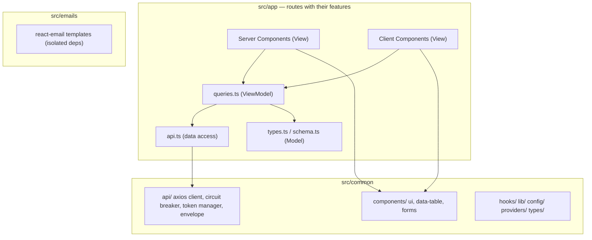

# Penyzen Frontend — Recommended Architecture

**Scope:** `apps/web` and its contract with `packages/shared`

**Purpose:** one place to see the architecture we build toward — responsibilities, structure, and the patterns we actually use — so changes are predictable and any developer can move with confidence

**How to read this doc**

- **Principles** — the non-negotiable rules that shape every decision.
- **Architecture** — the layers, boundaries, and dependency direction.
- **Structure** — where code lives.
- **Migration** — how the current codebase gets there.

**Contents**

1. Architecture principles
2. Target architecture: Clean + DDD + MVVM on the Next.js App Router
3. Layers and the dependency rule
4. Recommended folder structure
5. Feature folders (route-colocated)
6. The HTTP layer: an axios client
7. Server state with TanStack Query
8. Forms with React Hook Form + Zod
9. UI system: shadcn/ui + Tailwind
10. Email templates
11. Next.js rendering and routing patterns
12. Auth and route protection
13. Error handling and resilience
14. The state management map
15. Testing
16. Migration path
17. Golden rules

---

## 1. Architecture principles

- **Server-first.** React Server Components are the default; `"use client"` is the exception at the leaves.
- **Routes are thin.** A route file composes; the feature's data and pieces live beside it.
- **One HTTP client.** All network calls go through the axios client in `common/api`; nothing calls `fetch` directly.
- **One query layer.** All server state flows through TanStack Query; no ad-hoc `useEffect` fetching.
- **One form stack.** Every form is React Hook Form + Zod through shared field adapters.
- **One UI system.** Primitives come from shadcn/ui; we compose, we do not fork.
- **Feature code is colocated.** A feature lives with its route; only genuinely shared code moves to `common`.
- **Errors are first-class.** Every route has loading, error, and not-found states.

---

## 2. Target architecture: Clean + DDD + MVVM on the Next.js App Router

- **DDD** gives us feature folders that own their language, types, and data access.
- **Clean Architecture** gives the dependency direction: routes depend on `common`, and `common` depends on nothing above it.
- **MVVM** maps cleanly onto the App Router:
  - **Model** — `types.ts` and `schema.ts` (domain types and Zod contracts).
  - **ViewModel** — `queries.ts`, `api.ts`, and `hooks/` (state and data-access logic).
  - **View** — `page.tsx` and `_components/` (rendering only).
- **Next.js App Router** provides routing, streaming, and the server/client split.



---

## 3. Layers and the dependency rule

| Layer | Contains | May depend on | Must not depend on |
|---|---|---|---|
| `app/` routes | Pages, layouts, route boundaries, and each feature's `types.ts`, `api.ts`, `queries.ts`, `schema.ts`, `_components/` | `common`, shared contract types | `fetch`, Prisma, secrets, another feature's internals |
| `common/` | axios client, circuit breaker, token manager, envelope, UI primitives, hooks, lib, config, providers | External packages only | Any route or feature |
| `emails/` | react-email templates | react-email and shared types | Any app or route code |

**The rule:** dependencies point toward `common`. A feature never imports another feature's internals; shared pieces move up to `common`.

---

## 4. Recommended folder structure

```text
apps/web/src/
  app/                              # Next.js App Router
    (auth)/                         # public pages (route group)
      sign-in/page.tsx
      sign-up/page.tsx
    dashboard/                      # authenticated area
      campaigns/                    # <feature>
        page.tsx
        loading.tsx
        error.tsx
        not-found.tsx
        types.ts                    # Model: domain types
        api.ts                      # data access: typed calls through the client
        queries.ts                  # ViewModel: queries + mutations (calls api.ts)
        schema.ts                   # Model: Zod schemas + inferred types
        _components/                # components only this route uses
          campaign-card.tsx
          campaign-form.tsx
        [campaignId]/               # <subfeature>
          page.tsx
          _components/
      pledges/                      # another <feature>
    admin/                          # admin area
      users/                        # <feature>
        page.tsx
        types.ts
        api.ts
        queries.ts
        _components/
    layout.tsx
    page.tsx
    providers.tsx                   # client providers composition root
    globals.css
    not-found.tsx                   # root not-found
    error.tsx                       # root error boundary
    global-error.tsx                # fatal fallback

  common/                           # reusable, cross-cutting
    api/
      client.ts                     # axios instance + interceptors
      circuit-breaker.ts            # fail fast on unstable external calls
      token-manager.ts              # auth token access (Amplify)
      api-response.ts               # envelope types + unwrap helpers
      api-error.ts                  # normalized error type + guards
    components/
      ui/                           # shadcn/ui primitives
      data-table/                   # table + pagination
      forms/                        # RHF field adapters + form shell
      feedback/                     # toasts, empty, error, skeleton
      index.ts                      # barrel: export every shared component
    hooks/                          # generic hooks
    lib/                            # cn, currency, date, formatters
    config/                         # env, constants, navigation
    providers/                      # QueryClient, theme, auth providers
    types/

  emails/                           # react-email templates (isolated deps)
    welcome-email.tsx
    campaign-published-email.tsx
```

Mapping from today's layout:

| Today | Target |
|---|---|
| `src/components/*` | `common/components/*` |
| `src/lib/*` | `common/lib/*` |
| `src/app/**` page logic | colocated under the route feature (`queries.ts`, `_components/`) |
| `src/app/api/*` route handlers | keep, or move the logic into the owning feature |

---

## 5. Feature folders (route-colocated)

A feature lives where its route lives. The folder is the vertical slice.

```text
app/dashboard/campaigns/
  page.tsx            # route entry (View)
  loading.tsx         # skeleton
  error.tsx           # error boundary
  not-found.tsx       # 404
  types.ts            # Model: domain types
  api.ts              # data access: typed calls through the client
  queries.ts          # ViewModel: queries and mutations, calling api.ts
  schema.ts           # Model: Zod schemas + inferred input types
  _components/        # components only this route uses
    campaign-card.tsx
    campaign-form.tsx
  [campaignId]/       # subfeature
    page.tsx
    _components/
```

Rules:

- `_components/` holds route-private components; the leading underscore keeps the folder out of routing.
- `api.ts` holds the feature's data-access functions and is the only file that calls `common/api/client.ts`. `queries.ts` calls `api.ts`; components never call the client directly.
- `queries.ts` holds both queries and mutations for the feature. Do not split a separate `mutations.ts` — that split is only worth it once we also introduce a `query-keys.ts`, so we keep it unified for now.
- `schema.ts` owns the Zod schemas and their inferred types; `types.ts` holds domain types.
- Reuse across features moves up to `common`, never sideways into another feature.

---

## 6. The HTTP layer: an axios client

All network calls go through one axios instance in `common/api/client.ts`. Each feature's `api.ts` is the only place that calls this client; `queries.ts` calls `api.ts`, and components never touch the transport directly.

- **`client.ts`** — the axios instance: base URL, defaults, and interceptors.
- **`token-manager.ts`** — attaches the auth token (Amplify) and a correlation id to each request.
- **`circuit-breaker.ts`** — wraps unstable external calls so a failing dependency fails fast instead of hanging.
- **`api-response.ts`** — the shared envelope types and the helpers that unwrap them.
- **`api-error.ts`** — one normalized `ApiError` type the whole UI can act on.

Responsibilities:

- **Base URL and defaults** from config, not scattered strings.
- **Response interceptor** — unwrap the envelope, map `{ success: false, error }` into `ApiError`, and surface a correlation id.
- **Timeout and retry** — configured once.
- **No secrets in the browser** — only public config is exposed.

```ts
// the shape the whole app relies on
type ApiEnvelope<T> =
  | { success: true; data: T; meta?: Record<string, unknown> }
  | { success: false; error: { code: string; message: string; fields?: Record<string, string[]> } };
```

This pairs with the backend envelope (ERR-2) so the two sides share one contract.

---

## 7. Server state with TanStack Query

Server state is not client state. It lives in TanStack Query, defined in each feature's `queries.ts`.

- **Every hook is `use*`** — `queries.ts` exports hooks and nothing else: `useCampaigns`, `useCampaign`, `useCreateCampaign`, `useUpdateCampaign`, `useDeleteCampaign`. The name says exactly what the component gets.
- **`queryOptions` inside the hooks** — define each query once with `queryOptions(...)` so it can be reused for prefetching and hydration, then expose it through a `use*` hook.
- **`api.ts` is the transport seam** — `queries.ts` never calls the client directly; it calls the feature's `api.ts`, which calls `common/api/client.ts`.
- **Queries and mutations together** — both live in the feature's `queries.ts`; there is no separate `mutations.ts` and no shared `query-keys.ts` for now.
- **Server prefetch + hydration** — fetch in a Server Component and hydrate to the client to avoid waterfalls.
- **Invalidate what the mutation affects** — mutations invalidate the queries they change.
- **Optimistic updates** — for fast, reversible actions, with rollback on error.
- **Pagination and infinite queries** — built from the shared primitives in `common`.
- **Sensible defaults** — `staleTime`, retry, and error handling configured once where the QueryClient is created in `common/providers`.
- **Suspense + error boundaries** — mount queries inside the route's `loading`/`error` boundaries.

```ts
// app/dashboard/campaigns/api.ts — data access only
export const campaignsApi = {
  list:   (filters: CampaignFilters)             => client.get<Campaign[]>('/campaigns', { params: filters }),
  get:    (id: string)                            => client.get<Campaign>(`/campaigns/${id}`),
  create: (input: CreateCampaignInput)            => client.post<Campaign>('/campaigns', input),
  update: (id: string, input: UpdateCampaignInput)=> client.patch<Campaign>(`/campaigns/${id}`, input),
  remove: (id: string)                            => client.delete<void>(`/campaigns/${id}`),
};
```

```ts
// app/dashboard/campaigns/queries.ts — the use* hooks
import { useQuery, useMutation, useQueryClient, queryOptions } from '@tanstack/react-query';
import { campaignsApi } from './api';

export const campaignsQueryOptions = (filters: CampaignFilters) =>
  queryOptions({
    queryKey: ['campaigns', 'list', filters],
    queryFn: () => campaignsApi.list(filters),
  });

export function useCampaigns(filters: CampaignFilters) {
  return useQuery(campaignsQueryOptions(filters));
}

export function useCampaign(id: string) {
  return useQuery({
    queryKey: ['campaigns', 'detail', id],
    queryFn: () => campaignsApi.get(id),
  });
}

export function useCreateCampaign() {
  const queryClient = useQueryClient();
  return useMutation({
    mutationFn: (input: CreateCampaignInput) => campaignsApi.create(input),
    onSuccess: () => queryClient.invalidateQueries({ queryKey: ['campaigns', 'list'] }),
  });
}

export function useUpdateCampaign(id: string) {
  const queryClient = useQueryClient();
  return useMutation({
    mutationFn: (input: UpdateCampaignInput) => campaignsApi.update(id, input),
    onSuccess: (campaign) => {
      queryClient.setQueryData(['campaigns', 'detail', id], campaign);
      queryClient.invalidateQueries({ queryKey: ['campaigns', 'list'] });
    },
  });
}

export function useDeleteCampaign() {
  const queryClient = useQueryClient();
  return useMutation({
    mutationFn: (id: string) => campaignsApi.remove(id),
    onSuccess: (_void, id) => {
      queryClient.removeQueries({ queryKey: ['campaigns', 'detail', id] });
      queryClient.invalidateQueries({ queryKey: ['campaigns', 'list'] });
    },
  });
}
```

Using them in a component — the whole CRUD surface reads the same way:

```tsx
"use client";

import {
  useCampaigns,
  useCreateCampaign,
  useUpdateCampaign,
  useDeleteCampaign,
} from "./queries";

export function CampaignList() {
  const { data: campaigns, isPending, error } = useCampaigns({ status: "active" });
  const createCampaign = useCreateCampaign();

  if (isPending) return <CampaignListSkeleton />;
  if (error) throw error; // caught by the route's error.tsx

  return (
    <>
      <button
        onClick={() => createCampaign.mutate({ title: "New campaign" })}
        disabled={createCampaign.isPending}
      >
        Create
      </button>

      {campaigns?.map((campaign) => (
        <CampaignRow key={campaign.id} campaign={campaign} />
      ))}
    </>
  );
}

function CampaignRow({ campaign }: { campaign: Campaign }) {
  const updateCampaign = useUpdateCampaign(campaign.id);
  const deleteCampaign = useDeleteCampaign();

  return (
    <div>
      {campaign.title}
      <button onClick={() => updateCampaign.mutate({ title: "Renamed" })}>Rename</button>
      <button onClick={() => deleteCampaign.mutate(campaign.id)}>Delete</button>
    </div>
  );
}
```

Client state (UI-only) is Zustand. Form state is React Hook Form. That is the whole state story (see section 14).

---

## 8. Forms with React Hook Form + Zod

Every form uses the same stack and the same shared components, wired through a small **field adapter** so no form repeats boilerplate:

- **Schema first** — define a Zod schema in the feature's `schema.ts`; infer the type with `z.infer`. One source of truth for validation and types.
- **`zodResolver`** — wire the schema into React Hook Form.
- **Field adapters** — `TextField`, `SelectField`, `TextareaField`, and a `Form` shell in `common/components/forms` that adapt React Hook Form's controller into reusable, typed fields.
- **Server validation** — map the backend `error.fields` back onto the matching fields.
- **Accessible errors** — fields are labeled and errors announced via `aria-live` (pairs with frontend P4).
- **Typed submit** — the submit handler receives a typed, validated payload.

---

## 9. UI system: shadcn/ui + Tailwind

Use shadcn/ui for primitives and Tailwind for styling. We compose; we do not fork.

- Add components with the shadcn CLI into `common/components/ui`.
- Export every shared component from `common/components/index.ts` so imports stay short and consistent.
- Variants via `class-variance-authority`; class merging via `cn`.
- Design tokens (color, spacing, radius) come from the Tailwind config and CSS variables — no hard-coded colors.
- Accessible primitives under the hood (Radix) — keep the accessibility we get for free.
- One place for common feedback UI: toasts, empty states, error states, skeletons.

---

## 10. Email templates

Email templates live in `src/emails`, separate from the app, so the react-email dependency is not pulled into the rest of the frontend.

- Templates are React components with typed props.
- `src/emails` imports react-email and shared types only — it never imports route or app code.
- Templates are rendered to HTML on the server and handed to the backend/email service.
- Keep a preview available locally with the react-email dev server; snapshot-test the rendered output.

---

## 11. Next.js rendering and routing patterns

- **Server Components by default.** Fetch on the server; pass data down.
- **Client Components at the leaves.** Add `"use client"` only where you need interactivity.
- **Route groups** `(auth)` and area folders `dashboard`, `admin` organize without leaking routing concerns.
- **Streaming** with `loading.tsx` and `<Suspense>` so slow parts do not block the page.
- **Route handlers** (`app/api/*`) only when a browser-to-server proxy is genuinely needed.
- **Server Actions** for simple mutations tied to a form, with revalidation.
- **Metadata API** for titles, descriptions, and social tags per route.
- **Caching and revalidation** chosen deliberately (`revalidate`, tags), never by accident.

---

## 12. Auth and route protection

- **Token storage** decided once: prefer httpOnly cookies set by the server over tokens in `localStorage`.
- **Middleware** guards route groups; unauthenticated users are redirected to sign-in.
- **Session access** through one auth provider in `common/providers`; components read a single hook.
- **Role checks** mirror the backend; forbidden states render a message, not a broken page.

---

## 13. Error handling and resilience

This is the complete Next.js error surface (see P5 in the frontend review):

| File / API | Purpose |
|---|---|
| `global-error.tsx` | Fatal errors; replaces the root layout; must render `<html>` and `<body>` |
| `error.tsx` | Recoverable route errors; shows a friendly message and a `reset()` retry |
| `not-found.tsx` + `notFound()` | 404 for unknown routes and missing resources |
| `loading.tsx` + `<Suspense>` | Streaming skeletons for slow routes |

Resilience rules:

- Map API status to UI: **401 → sign in**, **403 → forbidden**, **404 → not-found**, **5xx → retry message**.
- Normalize every error in the axios interceptor so the UI reads one type.
- The circuit breaker guards unstable external calls so the app fails fast instead of hanging.
- Show a **correlation id** from the API so support can trace the request.
- No stack traces or raw error objects in production UI.
- Provide a retry action wherever retrying can succeed.

---

## 14. The state management map

Pick the right tool for the kind of state. Never mix them.

| Kind of state | Tool | Example |
|---|---|---|
| Server data | TanStack Query (`queries.ts`) | Campaign list, pledge totals |
| Client/UI state | Zustand | Sidebar open, theme, wizard step |
| Form state | React Hook Form | Campaign create form |
| URL state | Search params | Filters, pagination, sort |
| Auth session | Auth provider hook | Current user, roles |

Rule: if it comes from the server, it is TanStack Query — not Zustand, not `useState`.

---

## 15. Testing

Tests live under `tests/`, mirroring the feature structure — the same convention as the backend.

```text
apps/web/tests/
  campaigns/
    campaign-form.spec.tsx
    campaign-list.test.tsx
  auth/
  common/
```

| Scope | Where | Stack |
|---|---|---|
| Unit and components | `apps/web/tests/<feature>/*.{spec,test}.ts(x)` | Vitest + Testing Library |
| Server/API integration | `apps/web/tests/<feature>/*.test.ts(x)` | Vitest + MSW |
| End-to-end | `e2e/` at the repo root | Playwright |

Rules:

- Use `.spec.ts(x)` for unit and component tests, `.test.tsx` for integration tests.
- The axios client is the single mock point (MSW), so integration tests stay stable.
- End-to-end tests run with Playwright from the root `e2e/` folder.

---

## 16. Migration path

1. **Stand up `common/api`.** Move to one axios client, circuit breaker, and token manager, with the shared envelope and normalized error. (Depends on ERR-2.)
2. **Adopt `common/components`.** Move existing components to shadcn/ui primitives, forms, and data-table, with a single barrel export.
3. **Add the error surface.** `global-error`, `error`, `loading`, `not-found` per route group (P5).
4. **Colocate each feature.** Move its data, schemas, and pieces next to its route: `types.ts`, `api.ts`, `queries.ts`, `schema.ts`, `_components/`.
5. **Convert forms** to React Hook Form + Zod through the shared field adapters, mapping backend `error.fields`.
6. **Move email templates** into `src/emails`.
7. **Repeat per feature**, deleting old folders as each slice is migrated.

Migrate behind unchanged routes so each step ships independently.

---

## 17. Golden rules

- Server state lives in TanStack Query; queries and mutations live together in the feature's `queries.ts`.
- A feature's `api.ts` is the only file that calls the client; `queries.ts` calls `api.ts`.
- All network calls go through the axios client; no direct `fetch`.
- All forms are React Hook Form + Zod through the shared field adapters.
- All UI primitives come from shadcn/ui; compose, do not fork.
- Feature code is colocated with its route; reuse moves up to `common`.
- Features never import each other's internals.
- Email templates live in `src/emails` so react-email stays isolated.
- Every route ships with loading, error, and not-found states.
